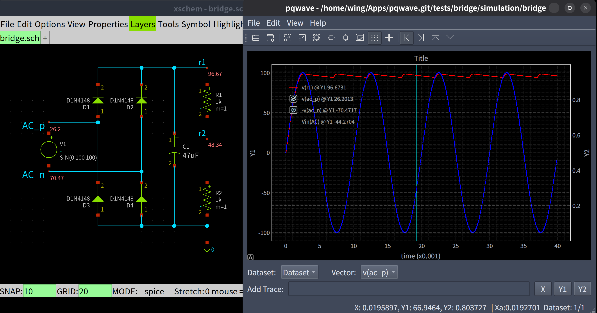
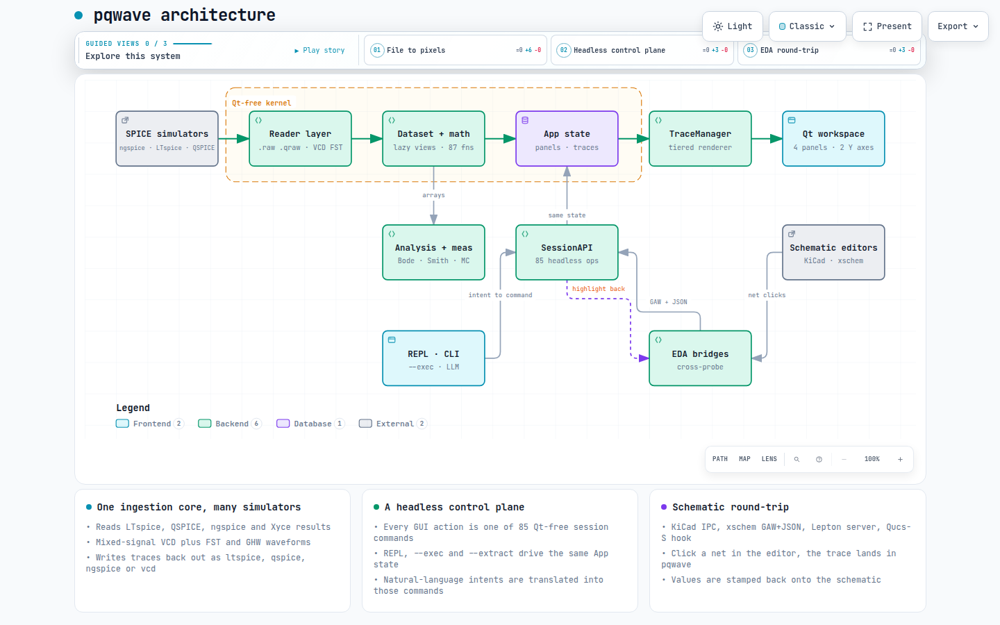

# pqwave

**A waveform viewer for people who have outgrown the simulator's own plotter.**

pqwave opens the result files that ngspice, Xyce, LTspice and QSPICE leave behind, the
VCD/FST/GHW dumps that mixed-signal runs leave behind, and then gives you an
instrument bench on top of them: 87 registered functions, 31 measurement operators,
Bode/Nyquist/Smith/polar dialogs, a real Monte-Carlo statistics workbench, and an
eye-diagram renderer — all of it scriptable from a headless API, all of it under MIT.



```bash
pip install -r requirements.txt && python pqwave.py your_circuit.raw
```

The examples below use `tests/bridge.raw`, the small sample capture that ships with the
repository.

---

## Architecture



The same diagram as an interactive, zoomable, themeable page — search, focus,
relationship tracing and PNG/SVG/WebM export:
**[docs/arch/pqwave-architecture.html](docs/arch/pqwave-architecture.html)**
(source spec: [`pqwave.architecture.json`](docs/arch/pqwave.architecture.json)).

The load-bearing detail is the **Qt-free kernel**. Everything that understands data —
parsing, the expression engine, analysis, measurement, the whole `SessionAPI` — never
touches Qt. That is why the same 85 commands work from a menu click, a REPL, a shell
flag and a CI job with no display attached.

---

## Why this exists

Every SPICE tool ships a plotter, and every plotter is built for one job: show *this*
run, from *that* simulator, well enough to eyeball it. That stops being enough the
moment your work is any of these:

- **You use more than one simulator.** LTspice will not open your ngspice run next to
  your QSPICE run. pqwave reads all of them — including QSPICE's `.qraw`, Xyce's
  output, and ASCII raw files — and plots them in the same window, on the same axes.
- **You need numbers, not eyeballs.** `rise_time`, overshoot, settling time, THD,
  SINAD, SNR, SFDR, slew rate, duty cycle and 22 more, written the way you would
  write a `.meas` line, evaluated against any expression you can type.
- **You ran a Monte-Carlo sweep and now what?** 500 overlaid traces are not an
  answer. Load the run as a collection and get yield against spec limits, a
  correlation matrix you can edit, parameter-sensitivity ranking, per-measurement
  histograms, envelope and spaghetti display modes, and a worst-N shortlist.
- **You want it automated.** There is no display, no GUI, no click-through:
  `pqwave --extract`, `pqwave --exec`, and an importable Python API that returns
  dictionaries and NumPy arrays.
- **You click nets all day.** pqwave cross-probes with KiCad, xschem, Lepton EDA and
  Qucs-S: click a net in the schematic, the trace appears; stamp simulated values back
  onto the drawing.

## What you get

### One ingestion core, many simulators

| Input | What it covers |
|---|---|
| `.raw` / `.qraw` | LTspice (UTF-16, `float32` data, complex AC), QSPICE, ngspice, Xyce — binary *and* ASCII |
| `.vcd` / `.fst` / `.ghw` | mixed-signal and digital results, incl. GHDL dumps |
| `.meas` lines | parsed and evaluated by pqwave's own engine |
| JSON | saved sessions and eye-diagram definitions |

Output is not a dead end either — `pqwave --convert` writes selected traces back out
as **ltspice, qspice, ngspice or VCD**, so a pqwave-only workflow can feed a viewer
you do not control.

### An analysis bench, not just a plotter

- **87-function registry behind a real parser**: recursive-descent infix evaluation, not a
  `eval`. Quoted vectors (`"v(out)"`), derived components (`mag()`, `db()`, `phase()`,
  `real()`, `imag()`), complex arithmetic, and sweep-aware references that resolve
  against the right Monte-Carlo step.
- **Impedance in the form you want**: toggle polar ↔ rectangular with SI prefixes,
  straight in the cursor readout.
- **One-click dialogs**: Bode (magnitude + phase), Nyquist, Smith (with a three-line
  Γ / z / Z readout), polar grid, FFT, histogram, power (instantaneous and average),
  worst-case with corner enumeration and temperature-coefficient sensitivity.
- **Dual Y axes, up to 4 panels**, cursor pairs with delta and area readouts, marks,
  rebindable keybindings (`~/.pqwave/keybindings.json`), and saveable view templates
  that restore datasets, traces and axis configuration together.

### Monte-Carlo that answers "so what?"

```
mc_load('runs.raw', source_type='stepped')   mc_yield('v(out)', low=1.6, high=1.8)
mc_stats('v(out)')                           mc_sensitivity('v(out)')
mc_param('R1', [990, 1020, 1050])           mc_histogram('v(out)', bins=50)
mc_style('envelope', sigma=3)                mc_worst(n=5)
mc_correlation_load('matrix.csv')            mc_generate('params.csv', runs=500, seed=1)
```

Runs are first-class objects: filter them, nominate one as nominal, scatter a
measurement against a parameter, or open the correlation-matrix editor and write the
correlations back into the next generator run. The full walkthrough is in
**[docs/monte_carlo/guide.md](docs/monte_carlo/guide.md)**.

### Mixed-signal you can actually read

Digital and bus traces decode from VCD/FST/GHW with configurable thresholds, bus
slicing (`data[7:4]`), per-trace lane heights, and a genuine **eye diagram** renderer
driven by a saved JSON definition — so an analog transient and its bus traffic share
one X axis.

### A control plane you can script

```python
from pqwave.session.api import SessionAPI

s = SessionAPI()
s.load("tests/bridge.raw")      # {'file_type': 'raw', 'n_points': 4015,
                                #  'n_variables': 5, 'signals': [...]}
s.add("v(ac_p)")                # 'v(ac_p)'   -> the trace name
s.measure("pp(v(ac_p))")        # {'pp(v(ac_p))': 100.12586975097656}
```

Methods return the domain result and raise on failure; the `{"ok": ...}` envelope
belongs to the command layer (`ReplExecutor`, `--exec`) that the REPL and the EDA
bridges drive.

```bash
pqwave --exec "load('runs.raw')"              # one command -> its real JSON payload
pqwave --exec "load('r.raw'); add('v(out)')"  # ';' chains run for their side effects
pqwave --extract sim.raw v(out),v(in) -ngspice filtered.raw    # headless trace extract
```

Every GUI action goes through the same registry of 85 `@api_command` operations, so
the REPL, the CLI, the bridges and your own scripts cannot drift away from the
application. `pqwave --help-commands` lists them; a coverage test fails the build if a
new command ships undocumented.

### Round-trip with your schematic editor

| Editor | Path in | Path out |
|---|---|---|
| **KiCad** | IPC API, net/part selection | control bar, highlight |
| **xschem** | GAW *and* JSON over TCP (Alt+G) | cross-probe + **value back-annotation** onto the sheet |
| **Lepton EDA** | Scheme server + file watcher | menu additions, cross-probe, stale-bytecode detection |
| **Qucs-S** | one-click hook into its Ngspice setting | every simulation opens automatically |
| **QSPICE** | `.qsch` launch + `.qraw` pickup | — |

Multi-window routing is real: several pqwave windows register themselves, and a
`table_set`/`copyvar` command lands on the window that owns that raw file.

### Natural language, no cloud required

`pqwave --setup-llm` points the chat panel at any OpenAI-compatible endpoint,
including a local model server. Intents that match a template resolve
**deterministically with no model at all**, so the common cases are instant, offline
and predictable; only free-form phrasings fall through to the model.

### Built for the sizes real sims produce

A tiered renderer picks per trace: `PlotDataItem` with anti-aliasing under 500K
points, a static `PlotCurveItem` with AA off and manual downsampling to 1600 above
that, plus a 30 ms view-box throttle. 16 M-point transients pan and zoom without
fighting the toolkit — and `skipFiniteCheck=True` keeps validation where it belongs,
in the simulation, not in the paint path.

---

## How it compares

Cells describe what each tool is documented to do. pqwave's column is verifiable from
this repository; the others are generalities about closed tools and I would rather be
correct than clever — open an issue if a cell is wrong.

| | **pqwave** | LTspice | QSPICE | xschem `graph` | GTKWave |
|---|---|---|---|---|---|
| License | **MIT, full source** | proprietary freeware | proprietary freeware | open source | open source |
| Opens another vendor's raw file | **4 simulators + ASCII** | its own | its own | ngspice-oriented | no (VCD) |
| Runs with no display / CI | **yes** | no | no | no | partly |
| Scriptable from Python | **yes, importable** | no | no | no | no (Tcl) |
| Bode / Nyquist / Smith / polar dialogs | **all four** | AC traces only | AC traces only | no | no |
| 31 measurement operators + 87 functions | **yes** | `.meas` subset | `.meas` subset | no | no |
| Monte-Carlo: yield, correlation matrix, sensitivity | **yes** | no | no | no | no |
| Digital VCD / FST / GHW + eye diagram | **yes** | own sim only | own sim only | no | yes (its specialty) |
| Cross-probe + back-annotate a schematic | **4 editors** | own schematic | own schematic | own sheet | no |
| Natural-language / REPL control | **yes** | no | no | no | no |

**The short version:** the simulator's plotter is a viewer with an expression field.
pqwave is an analysis front end that happens to also be a viewer — and unlike them, it
is a library you can call.

---

## Install

```bash
git clone https://github.com/niuniuaba/pqwave.git && cd pqwave
python -m venv venv && source venv/bin/activate
pip install -r requirements.txt          # or: pip install -e .
```

Needs Python ≥ 3.8, PyQt6, pyqtgraph, NumPy, SciPy, spicelib, eyediagram. Optional:
`pip install -e ".[dev]"` for tests/lint, `".[headless]"` for matplotlib export.

## Command line

```bash
pqwave file.raw                 # open it            pqwave --debug file.raw
pqwave --exec "load('a.raw')"   # run commands, exit pqwave --extract in.raw v(out) -qspice out.qraw
pqwave --version                # 0.3.4             pqwave --test   # full suite, isolated
```

Flags: `--version` `--test` `--debug` `--verbose` `--quiet` `--log-file FILE`
`--xschem-port PORT` `--no-xschem-server` `--xschem-send CMD` `--xschem-ba-port PORT`
`--extract` `--convert` `--qspice-bridge` `--sch-path` `--qucs-bridge`
`--setup-qucs-integration` `--connect` `--exec` `--setup-llm` `--help-commands`

## Development

```bash
pytest                      # ~960 tests, ~11 s, one process
pytest pqwave/tests/test_bode.py -q
python pqwave.py --test     # each test file in its own subprocess
make lint                   # flake8 + mypy
make format                 # black — see the note below
make test-isolated
```

`pqwave/tests/conftest.py` owns the shared `QApplication` and resets the
`ApplicationState` / `WindowRegistry` singletons, so the suite runs in one process
without order dependence. Tests that need TCP loopback or a git-ignored data capture
skip with a stated reason rather than fail.

**Formatting:** black is the declared formatter but has never been run repo-wide, so
`make format` will rewrite nearly every file. Treat that as its own
`style: run black` commit, never fold it into a fix. `AGENTS.md` records the current
lint/type baselines so nobody has to rediscover them.

## Documentation

| Topic | Where |
|---|---|
| Monte-Carlo guide | [docs/monte_carlo/guide.md](docs/monte_carlo/guide.md) |
| Session/REPL API | [docs/cli-api-prd.md](docs/cli-api-prd.md) |
| Back-annotation | [docs/back-annotation.md](docs/back-annotation.md) |
| xschem integration | [docs/xschem_integration.md](docs/xschem_integration.md) |
| KiCad bridge | [docs/kicad/guide.md](docs/kicad/guide.md) · [lessons learned](docs/kicad/lessons-learned.md) |
| Qucs-S bridge | [docs/qucs/guide.html](docs/qucs/guide.html) |
| Mixed-signal | [docs/mixed_signal_prd.md](docs/mixed_signal_prd.md) · [gap analysis](docs/mixed_signal_gap.md) |
| Accepted specs / design history | `openspec/specs/`, `docs/superpowers/` |

## License

MIT — see [LICENSE](LICENSE).
